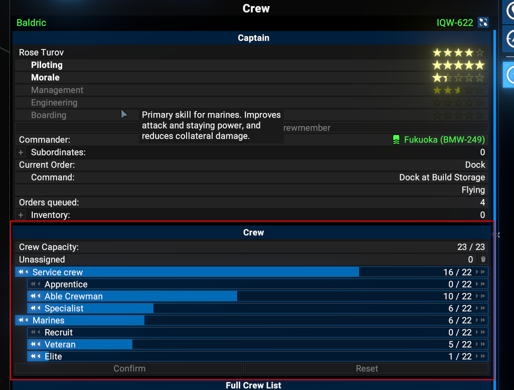
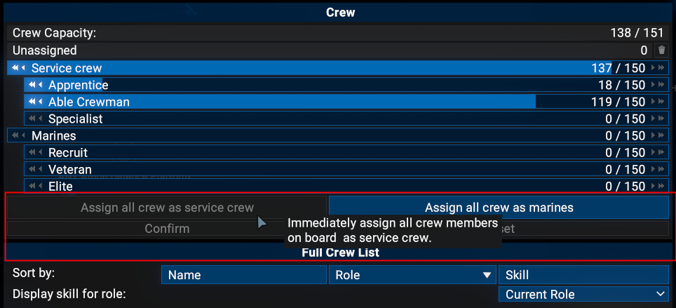

# Assign Crew (X4: Foundations)

Adds two buttons to a ship's crew panel (**Map > Information > Crew**). Each one reassigns
everyone on board, except the captain, in one click:

- **"Assign all crew as service crew"**
- **"Assign all crew as marines"**

**Before** (vanilla crew panel):



**After** (with this mod): the buttons sit directly above **Confirm / Reset**, in the area marked
in red. Here all crew are already service crew, so that button is greyed out.



## Behaviour

- Applied **immediately**, with no Confirm needed.
- People moved: all members of the other role plus all **unassigned** crew.
- Not touched: the captain/pilot, passengers, prisoners and trainees.
- People still in transit to the ship are skipped.
- Any unconfirmed slider changes in the panel are discarded.
- A button is greyed out when there is nobody to move. Buttons only appear on player-owned ships.

## Requirements

- X4: Foundations **9.00** or newer.
- **No other mods required.** It works with or without kuertee's *UI Extensions and HUD*.

## Installation

Copy or clone this repository into the game's `extensions` folder so the path is:

```
X4 Foundations/extensions/x4_ext_assign_crew/content.xml
```

For example, on Linux/Steam:

```sh
git clone git@github.com:therapiestation/x4_ext_assign_crew.git \
  ~/.steam/steam/steamapps/common/"X4 Foundations"/extensions/x4_ext_assign_crew
```

Enable it under **Extensions** in the game menu if needed. It is safe to add to or remove from
existing saves (`save="0"`).

## Languages

English and German.

## How it works

The mod loads a single Lua file (`ui/assign_crew.lua`) through `ui.xml`. It wraps the map menu's
`menu.addCrewSection()` to insert the button row before the Confirm/Reset row. The buttons use the
same engine call as the vanilla Confirm button (`ReassignPeople`). If a future game patch changes the
crew panel, the buttons simply stop appearing. Look for `[AssignCrew]` in the debug log.

## Troubleshooting

Start the game with `-debug all -logfile debug.log` and search the log for `[AssignCrew]`.
